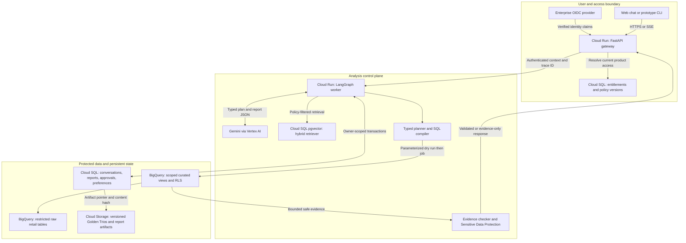
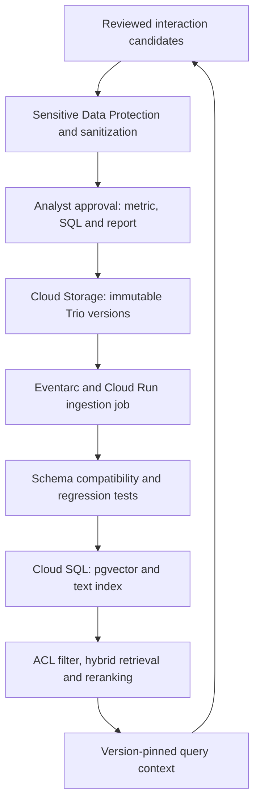
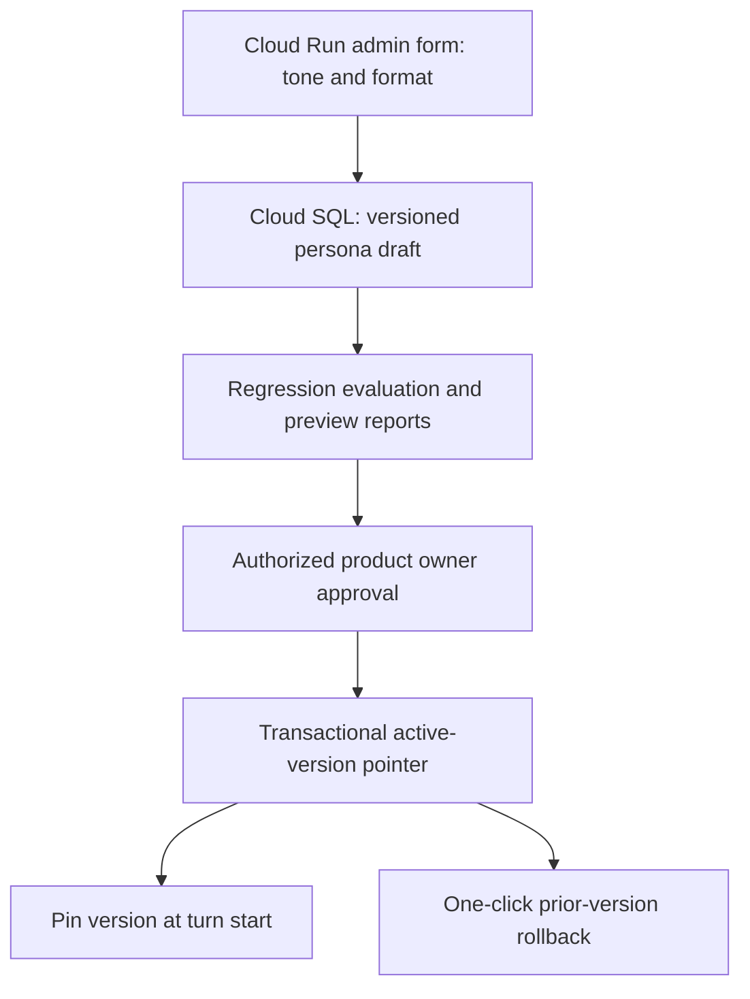

# Production high-level design

## Objective and assumptions

Executives ask retail analysis questions, inspect evidence, refine the analysis, and save
or delete their own reports. Analysis is restricted to products assigned to the authenticated
user. OpsFleet is the client; the Team Lead and Harry own delivery/product decisions.
The retail company's data owner owns metric definitions, entitlements and privacy policy.

Assumptions are explicit so the prototype can be reviewed without blocking on discovery:

| Decision | Working assumption | Decision owner / production follow-up |
| --- | --- | --- |
| Cloud | GCP, because the source is BigQuery and Gemini is preferred | OpsFleet/platform owner confirms region and organizational standards |
| User identity | Enterprise OIDC subject is authoritative; email is not the authorization key | Client identity team |
| Product rights | A user-product entitlement table maintained outside chat | Retail data owner; test JSON substitutes locally |
| Report ownership | Private to creator; no delete rights on colleagues' reports | Team Lead/Harry confirm future sharing requirements |
| PII | Direct identifiers forbidden; opaque customer keys allowed for top-customer analysis | Privacy owner confirms whether pseudonyms must also be excluded |
| Time | UTC, half-open item-creation date ranges | Retail finance team confirms fiscal calendar and business timezone |
| Revenue | Completed-item sale price, excluding returned/cancelled items | Finance signs off; not accounting revenue or profitability |
| Churn | No subscription signal; definition must be agreed before a cohort extension | Analytics owner defines inactivity window and eligibility |
| Scale | Initial sizing target: 100 active executives, 10 simultaneous analyses | Validate from actual usage and load tests |
| Data freshness | Display source watermark; target hourly curated facts | Data platform owner confirms source ingestion SLA |
| Report retention | 30-day soft-delete recovery; 90-day chat trace retention proposed | Privacy/legal owner approves actual durations |

These are design assumptions, not facts about the client's undisclosed infrastructure.

## Request and storage topology

Arrows show calls/dependencies, not unrestricted data permissions. Raw PII never flows into
the model context. The live prototype reads the public dataset directly through the fixed
compiler; the production service reads an owned curated dataset and cannot read raw tables.

The warehouse principal must match the authorization design: impersonate a service account
for a stable entitlement group (or use supported end-user warehouse identities). Attach
row policies to those actual principals. `SESSION_USER()` with one shared, broadly privileged
service account **does not distinguish executives**. The shared query broker has no raw read
role. If dynamic entitlement groups cannot be represented safely, provision per-scope views
or separate datasets and broker identities. Test cross-group access against real IAM.

Curated views flatten item-grain facts and drop direct identifiers, with a dedicated
tokenization process for customer keys. Row policies restrict products. Column policy
tags deny PII. Query compilation adds product filters again for defense in depth. Authorized
views/RLS do not eliminate all inference or timing attacks; aggregate thresholds, query
rate limits and privacy review address those separately.

## Knowledge and improvement topology

Feedback produces candidates, not automatically trusted knowledge. A thumbs-up is not
approval to train on confidential data. A signed-off document's immutable ID, version,
schema/metric compatibility and scope travel with every report. Revisions invalidate
retrieval caches; revoked documents are filtered immediately and removed from embeddings.

## Persona change path

The editor exposes constrained fields, not the privileged system policy. The CEO can change
tone weekly without rebuilding or redeploying. Entitlements, tool rights, PII policy and
confirmation rules live outside this configuration. No persona text can grant permissions.

## Services, compute and rationale

| Component | Production choice | Rationale and trade-off |
| --- | --- | --- |
| API/UI delivery | Cloud Run FastAPI, HTTPS load balancer, SSE | Low operational burden; authenticate every request, stream progress; cap concurrency and deadlines |
| Workflow | LangGraph in a Cloud Run worker | Explicit nodes/branches, bounded repair and durable checkpoints; avoid an open-ended autonomous loop |
| LLM | Configurable stable Gemini Flash through Vertex AI | GCP integration, structured output, cost/latency balance; select exact model only after task evaluation |
| Prototype LLM | Google GenAI SDK with AI Studio key | Matches evaluator setup; production private-data processing requires an approved enterprise data agreement |
| Query engine | BigQuery owned curated facts + authorized views/RLS | Existing source, job-level cost caps, query audit; IAM adds a boundary beyond application code |
| Metadata/search | Cloud SQL PostgreSQL with pgvector + full-text search | Transactions for confirmation, JSON metadata, lexical/vector search together; validate scale before adding a dedicated vector store |
| Golden/artifact store | Cloud Storage versioned objects, CMEK where required | Immutable provenance, lifecycle controls, low-cost documents; never a public bucket |
| Slow jobs/exports | Cloud Tasks to dedicated Cloud Run workers | Backpressure, retries and idempotency; Pub/Sub/Eventarc for ingestion events |
| Secrets | Secret Manager + Workload Identity | No API keys in image/source; rotate and grant minimal runtime rights |
| Telemetry | OpenTelemetry to Cloud Trace/Logging/Monitoring | Trace graph steps and provider calls; payload collection is separately controlled |
| Security scanning | Sensitive Data Protection + deterministic schema suppression | Broader detection than regex, with fail-closed output handling; no guarantee against all inference |
| Optional hot cache | Memorystore only after measurement | Cache safe results keyed by user/scope/version and freshness; not needed for initial scale |

## Persistence model

| Store | Records | Boundary / lifecycle |
| --- | --- | --- |
| BigQuery raw | Four source tables, ingestion metadata | Restricted ingestion/curation principals only; separate data policy |
| BigQuery curated | Scoped item-grain facts, safe dimensions, tokenized customer key | Partition on event date, cluster by product ID; source watermark and data quality checks |
| PostgreSQL entitlements | Tenant, subject ID, product IDs, policy version | Admin writes; request-time check and recheck before query/export |
| PostgreSQL conversations | Owner, thread, sanitized messages, typed plans, evidence pointers | Owner RLS, encryption, approved retention, no hidden chain-of-thought |
| PostgreSQL reports | Owner, conversation, version, status, content hash, artifact URI | Private by default, transactional versioning, soft deletion |
| PostgreSQL confirmations | Token hash, owner, thread, selected IDs/versions, expiry, used status | Short-lived, atomic consume; never store plaintext token |
| PostgreSQL preferences | Owner, format/depth/chart settings, source, confidence | Explicit choices override inferred values; inspect/reset and opt out |
| Golden objects + index | Question, SQL template, report, definitions, reviewer, ACL, embedding/version | Approved only; shared methodology contains no private result values |
| Telemetry | Stage, model/version, timing, safe error code, usage, job IDs | Metadata by default; tightly controlled redacted payload trace store if approved |

At initial scale, one regional HA Cloud SQL instance and autoscaled Cloud Run workers are
adequate hypotheses, not capacity guarantees. Use database connection pooling and cap
worker concurrency to warehouse/API quotas. Isolate customer tenants in data and identity;
separate tenant databases/datasets if the client's isolation requirements demand it.

