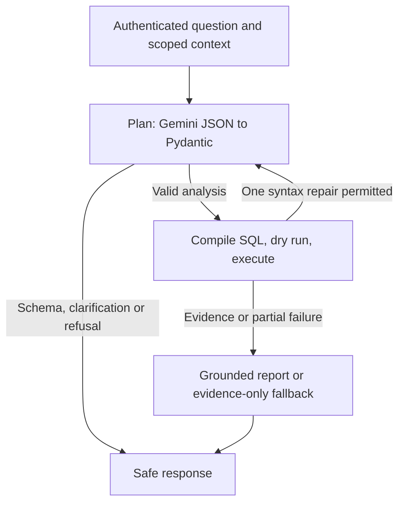

# Technical design and requirement coverage

## 1. Execution model and framework choice

The prototype runs a small LangGraph `StateGraph`:



LangGraph makes branches, state updates, and repair paths explicit and testable. Pydantic
rejects unknown tools, arbitrary SQL, invalid enums, duplicate metrics, invalid dates and
unselected sort columns. The Google GenAI SDK provides native Gemini access without a
second agent/tool abstraction. There is no generic Python, shell, browser or SQL execution
tool available to the model. SQL generation means constructing parameterized SQL from a
typed analysis representation, not executing arbitrary model strings.

The supplied professional background describes hands-on Python, LangGraph/LangChain,
RAG, typed tools, evaluation and production observability. That is the relevant experience
behind this framework choice; it does not imply experience deploying every GCP service
proposed in the HLD. The source is deliberately small enough to explain and maintain
without depending on undocumented framework behavior.

The CLI is a single-process, single-active-turn client. Graph state is not a global shared
conversation. A production worker receives immutable context containing tenant, verified
subject, entitlement version, request ID, persona version and deadline. Persist checkpoints
in PostgreSQL with tenant/owner RLS; omit secrets and raw identifiers. Queue long report
jobs and allow cancellation. Never replay a destructive side effect during workflow resume.

## 2. End-to-end data flow

1. The gateway verifies OIDC token issuer/audience/signature/expiry and resolves the internal
   subject. The local prototype substitutes a trusted `--user` argument.
2. Read current product rights from the entitlement store. Refuse unknown/no-access users.
   Snapshot the persona and metric/schema versions for this turn. Resolve explicit preference.
3. Redact obvious user-supplied direct identifiers, restrict input length and classify intent.
   Explicit PII requests are refused locally; the planner only handles analysis/schema/clarify/refuse.
4. Retrieve approved, scope-compatible Golden Trios. Include method/metric definitions and
   IDs; never import historical report numbers as current evidence.
5. Gemini returns a typed plan of at most three queries. Python validates every field, checks
   requested product IDs against entitlement and compiles safe SQL. Product rights do not
   come from conversation text, the model, or a retrieved document.
6. BigQuery performs a dry run, then executes under a bytes cap, deadline and deterministic
   request-scoped job ID. Read at most `limit + 1` rows to detect truncation. All joins occur
   within the warehouse; the source is restricted before aggregation.
7. Only approved aggregate dimensions/metrics and opaque customer labels enter report
   generation. Each evidence row gets a stable within-turn reference such as `q1:r2`.
8. Gemini produces observations, hypotheses, actions and limitations. Python checks evidence
   references, redacts output and renders the actual evidence tables. Failed report generation
   returns evidence plus a safe next step. Production adds deeper claim verification and DLP.
9. Return answer, dates/scope and trace ID. Save an owner-scoped report when explicitly
   requested; report creation never grants data access. Record usage and safe audit metadata.

No production application service needs write access to the source database. Report
library writes use a separate transaction boundary and database role.

## 3. Data and metric semantics

The source is `bigquery-public-data.thelook_ecommerce` with the four requested tables.
The compiler selects one row per `order_items` item, joins `orders` on order ID and user ID,
`products` on product ID, and `users` on user ID. It never sums `orders.num_of_item` or
duplicates a header-level total across items. `order_items.sale_price` is the item price.
The item status, not the order header status, determines included completed revenue.
Inner joins assume valid referential integrity; production quality checks detect missing
dimension/order rows before publishing a curated partition rather than silently dropping them.

| Metric | Definition | Interpretation |
| --- | --- | --- |
| `revenue` | Sum sale price where item status is `Complete` | Completed sales at item creation date, not finance recognition date |
| `units` | Number of `Complete` item rows | Each item row is one unit |
| `orders` | Distinct orders with any authorized item matching filters | Includes all item statuses; never the order's unauthorized product sales |
| `customers` | Distinct opaque customer keys across matching items | Includes all item statuses; not all registered users or website visitors |
| `avg_order_value` | Completed revenue / distinct orders with a completed matching item | Authorized portion of the order only; `NULL` when denominator is zero |
| `return_rate` | Returned item rows / all matching item rows | Item status fraction, not financial refund rate or a mature-cohort return rate |
| `sample_items` | Count of matching item rows | Sample size; includes all statuses |

Dimensions: UTC day/month, product ID, category, state, country, opaque customer key and
item status. Date windows are `[start_date, end_date)` using item creation time. Up-to-date
revenue reflects the source's current snapshot, not a guaranteed live transactional feed.
Historical statuses can change: reproducible finance reporting needs as-of snapshots.

By default the live planner proposes the preceding 12 complete months when no period is
specified and states that choice. Ambiguous year/fiscal quarter should produce clarification.
The demo always uses fixed synthetic Q1 2025 and says so. Display the exact selected range
even if the model fails to explain its default. A quarterly report can use monthly trends,
product comparisons and regional comparisons in three queries, then propose Q2 actions.

Top customers are ranked by **opaque per-user customer label**, never name/email/raw ID.
Revenue amounts use warehouse rounding; Python converts numeric results for JSON rendering.
No unsupported profitability claim is made because costs, marketing, promotions and stock
availability are not included in this prototype's approved semantic layer.

“Why” receives evidence of differences and explicitly labeled hypotheses. A state with
lower revenue can have fewer buyers, lower units/order or different product mix. These
tables alone cannot show that a campaign, competitor or outage caused the difference.
Churn is intentionally clarified: no subscription state exists, and a repeat-purchase
inactivity proxy needs an agreed cohort, inactivity duration, observation window and
product scope. Implement that as a separately tested semantic capability after approval.

## 4. Hybrid intelligence and the Golden Bucket

The prototype loads `knowledge/trios.json` and retrieves up to two approved records by
lexical overlap, filtering by schema version and product scope **before** selection. The
records are synthetic examples, clearly marked as such. The planner gets their questions,
SQL and analyst explanations but cannot execute their SQL. This demonstrates the retrieval
path beyond BigQuery while keeping the theoretical bucket reproducible locally.

Production Trio contract:

```json
{
  "id": "trio-immutable-id",
  "version": 3,
  "question": "Compare spend across two states",
  "sql_template": "approved parameterized analyst query",
  "analyst_report": "sanitized reasoning, assumptions, limitations and interpretation",
  "metric_version": "completed-sales-v1",
  "schema_version": "curated-item-v1",
  "tenant_id": "tenant-id",
  "product_scope": [1, 2],
  "status": "approved",
  "reviewer_id": "internal-reviewer-subject",
  "valid_from": "2026-11-01",
  "source_watermark": "immutable snapshot/version",
  "content_hash": "sha256"
}
```

At ingestion, scan for PII/secrets, normalize metric definitions, verify template safety and
run its regression queries against a fixed snapshot. Human analysts approve both the SQL
and interpretation. Store immutable object versions in private Cloud Storage; store metadata,
text index and embeddings in PostgreSQL. Prefer small semantic chunks that keep question,
method and definition together. Strip historical customer identities and private result values.

At query time: filter by tenant, product rights, approval, active version and compatible
metrics/schema; retrieve ~20 lexical/vector candidates, combine via reciprocal rank fusion,
rerank ~8, and include at most 3–5 short records within the prompt budget. Use a currently
supported embedding model selected by retrieval evaluation; embedding changes get a new
index version and backfill. If retrieval fails, do not silently claim expert grounding: use
the approved semantic catalog, mark Golden context unavailable, and refuse metrics whose
definitions cannot be established safely. Prototype configuration/knowledge loading errors
return a safe failure rather than silently bypassing the knowledge requirement.

Update loop: feedback → sanitized candidate → analyst review → regression evaluation →
approved object/version → ingestion event → index publication. Rejected/downvoted answers
enter an issue queue. Never promote a model's answer merely because another model likes it.
Maintain provenance, revoke obsolete examples, evaluate retrieval recall and track whether
retrieved logic helped. Golden content is untrusted input for tool authorization even after review.

## 5. Safety, product isolation and PII

There are three separate controls: authenticate who is asking, authorize which products
can be analyzed, and minimize which fields can leave the warehouse.

**Prototype enforcement:** all query specs are checked in Python; SQL always includes
`oi.product_id IN UNNEST(@allowed_products)` and a separately checked selected-products
predicate. All filter values, limits, dates and pseudonym secrets are BigQuery parameters.
Only enum-selected column expressions and a boolean sort direction are interpolated.
There is no input path for SQL identifiers, functions, raw statements, scripts, UDFs,
`EXPORT DATA`, `INFORMATION_SCHEMA`, or external connections. A broad-scope request
still runs only on assigned products; an explicit unassigned product is refused.

The raw joins use internal user/order IDs only in the warehouse. Direct identifier columns
such as first/last name, email, IP, street address, ZIP and exact coordinates are never
selected, given to Gemini, logged or saved by the query path. Product names and other
unconstrained catalog free text are deliberately not exposed. State/country are coarse
analytical dimensions; output has regex masking for emails, phone-like numbers and SSNs,
plus terminal-control character removal. This is not a claim of universal PII detection.

The CLI derives a per-user secret with HMAC-SHA256, then the BQ compiler derives an opaque
key with secret-prefixed SHA256 of the internal user ID. That SQL expression is **not HMAC**.
Only a short display label reaches the user. Store the master secret privately; do not grant
executives permission to inspect warehouse job parameters. In production use an approved
tokenization/HMAC pipeline before query execution, rotate keys with versioning, and keep
re-identification rights separate. Pseudonyms are still personal data and can be linkable.

**Production boundary:** read-only warehouse roles, private curated views, row policies
attached to actual scoped principals, PII column tags, enterprise identity and authorization
checks before queries, reports and exports. Enforce product grants at query time; changing
rights invalidates cached results and previously saved report access. Store source product
lineage with reports and recheck current entitlements before serving them. The local prototype
enforces report ownership but does not implement dynamic entitlement revocation of saved reports.

Minimum-group suppression (e.g. 5 distinct customers) should apply to geographic/demographic
aggregates, with explicit treatment of “top customers” as a separately authorized capability.
Rate-limit repeated overlapping slices to reduce differencing; aggregate suppression alone
is not differential privacy. The prototype does not implement small-cell privacy or inference
attack defenses. Agree those requirements before production rollout.

Prompt injection defenses include constrained plans, immutable code-side policy, data/instruction
separation, no model-visible destructive tool, no arbitrary execution/web/email, bounded inputs,
curated retrieval and safe output. A model intent classifier can still make mistakes; it is
not a security boundary. The fixed schema/compiler is the boundary. Production red-team
tests and egress inspection complement it. Persona changes cannot bypass Python or IAM.

## 6. Destructive operations and confirmation UX

Deletion lives outside the model graph. A small parser recognizes the two requested natural
commands plus explicit slash commands. Ambiguous deletion prompts receive command help.
The user can inspect or cancel the selection without authorizing deletion.

1. Select **only the current owner's** active reports, using a conversation filter or literal
   case-insensitive substring match on title/body. SQLite parameters and `instr` avoid SQL
   injection and wildcard widening. The prototype matches a literal phrase, not fuzzy semantics.
2. Show exact IDs/titles and count. For a production UI paginate large previews and display
   total count; do not execute a newly evaluated search at confirmation time.
3. Generate a cryptographically random token. Store its hash with owner, conversation,
   exact report IDs/versions, expiry, and unused status. New previews invalidate older ones.
4. Require the exact `/confirm TOKEN` input within 120 seconds. The model cannot supply it
   as a tool call. “Yes,” unrelated chat, wrong user/session, expired and replayed tokens fail.
5. In one database transaction lock the confirmation and reports, verify current ownership,
   active status and version, then soft-delete the entire selected snapshot and consume the token.
   Any changed report aborts the whole transaction. New matching reports survive.
6. Emit an audit event and a clear success/failure with trace ID. Soft-delete recovery and
   permanent purge follow a distinct retention policy; legal holds can prevent purge.

SQLite `BEGIN IMMEDIATE` serializes the prototype transaction. Production uses PostgreSQL
`SELECT ... FOR UPDATE` with an atomic token-consume condition and idempotency key. HTTP
authentication, CSRF protection where applicable and renewed entitlement checks protect
confirmation. An HTTP timeout is reconciled by operation ID instead of repeating the search.
Metadata deletion and artifact deletion use an outbox; mark the report inaccessible immediately,
then retry object cleanup. Storage versions/backups require explicit retention management.

## 7. User and system learning

Implemented: `/prefer tables|bullets` persists an explicit preference in SQLite by owner;
four recent typed plans support in-process follow-ups. There is no hidden raw transcript
memory or automatic inference about sensitive personal traits.

Production preferences include format, depth, chart/text choice and explanation detail.
Explicit settings override inferred preferences. Repeated choices can create low-confidence
suggestions such as “use concise tables”; let the user inspect, edit, reset and opt out.
Store provenance, confidence and expiry. Do not mix one user's preferences or confidential
facts into another user's context. Remember presentation choices, not product entitlements.

System learning is an offline, gated workflow: collect consented feedback and failure labels,
identify recurring intent/schema gaps, create reviewed benchmark cases and Golden candidates,
then evaluate a prompt/compiler/retrieval change against held-out data. Canary the winning
version, measure regressions and roll back if necessary. Fine-tuning is optional only after
rights, de-identification, data separation and incremental value are demonstrated. The
agent does not edit its own prompt or train on production conversations automatically.

## 8. Resilience, retries, empty results and cost control

| Failure | Prototype behavior | Production extension |
| --- | --- | --- |
| Invalid plan/JSON | One structured repair; unknown fields/metrics rejected | Track schema-specific errors and simplify context |
| Warehouse syntax rejection | One plan rebuild and recompile, original filters/date/scope locked | Compiler bugs need a code fix, never arbitrary SQL bypass |
| Empty result | One same-filter retry, then explicit no-data response | Diagnose coverage with approved metadata; suggest a change for user approval |
| Rate limit / transient BQ failure | One bounded retry; explicit job reconciliation after uncertain submission | Queue/backoff using Retry-After and per-provider concurrency controls |
| BQ timeout | Attempt job cancellation; safe timeout error | Async operation status, user cancel and bounded worker deadline |
| Access/quota/cost failure | No blind retry; fixed safe error code | Explain admin action or narrower approved analysis |
| Narrative generation failure | Return usable evidence with a labeled narrative fallback | Optional evaluated backup Gemini deployment under same data policy |
| Some queries fail | Mark partial report and show which evidence is unavailable | Let user retry failed operation only |
| Golden/config/SQLite failure | Safe failure, process stays interactive where possible | HA stores, circuit breakers and approved cached catalog |

Bounds are enforced in code: 4,000-character question; 3 queries; 1–100 returned rows/query;
at most 2 planning attempts; at most 5 physical model calls including retries; at most 6
warehouse runner calls across replanning; no SDK automatic continuation/retry loops; 25-second
model HTTP timeout; 15-second BQ submission/dry-run timeouts; 30-second result wait and
server job timeout. Provider timeouts are not a guarantee of exact wall-clock cancellation.
The server job timeout is best effort; the client also attempts cancellation on result timeout.

Each BQ execution has `maximum_bytes_billed`, default 1 GB, plus a dry run. Under those
on-demand caps, six executions reserve an upper envelope of 6 GB per turn; dry runs do
not incur query processing charges. This is a byte envelope, not a currency guarantee or
a guarantee for every billing mode. RLS can make dry-run estimates uninformative; retain
the execution cap. The code's job IDs include trace/query and SQL+filter fingerprint to
avoid accidentally reusing a previous plan's results after changing a parameter.

An empty retry reuses the same request job ID, so it reconciles/rechecks the same job rather
than inventing new data or broadening scope. It does not “repair” a genuinely empty dataset.
The empty response states this limitation. For truly invalid generated SQL, the bounded
rebuild can help an invalid plan; a deterministic compiler defect ultimately fails safely.

Production adds a shared per-turn token/byte/currency reservation ledger, an overall deadline,
provider-specific circuit breakers, per-user/tenant quotas, source freshness-aware caching and
backpressure. Cache keys include tenant/subject, entitlement version/product scope, query,
metric/schema version, source watermark and persona version where the cached value is prose.
Do not serve a stale confidential report as a fallback without rechecking authorization.

## 9. Persona management and extensibility

The prototype reloads `config/persona.json` each turn: tone, maximum findings and version.
No redeployment is required. Only recognized fields are used; Python authorization and
confirmation cannot change. This is operator-edited JSON, not a completed nondeveloper UI.

Production provides a role-protected form for CEO/product editors with draft, preview,
test results, approval, publish and rollback. Store immutable versions and an active pointer.
Pin each turn to one version and audit the publisher. Tone changes may still influence
model behavior, so run the safety/grounding suite before publication. The editor cannot
change the system's security policy, tool schemas or data grants.

Extend the typed capability registry rather than adding unrestricted tools:

| Extension | Contract and safeguards |
| --- | --- |
| Charts | Approved chart specs from safe evidence; deterministic plotting; validate labels and units |
| Email reports | Recipient selection/verification, current report ACL recheck, preview and explicit send approval; outbox/idempotency |
| Web trends | Isolated allowlisted retrieval, sources/timestamps, untrusted content; no customer data in web requests |
| Churn cohorts | Business-approved definition, tested cohort compiler, censoring/observation-window disclosure |
| Product names | Entitled catalog lookup, sanitized safe display labels, ambiguity clarification |
| Rich reports | HTML/PDF renderer from structured report/evidence, private objects and short-lived authorized download |

Each capability declares input/output schema, entitlement requirements, data classification,
timeout, budget, idempotency, approval policy, audit fields and evaluation cases. Planning
cannot grant itself a new capability. Slow/external side effects run in dedicated workers.

## 10. Prototype-to-production boundary

| Requirement | Runnable prototype | Production design |
| --- | --- | --- |
| Natural analysis and reports | Gemini typed plan, dynamic BQ SQL, evidence, actions, follow-ups | Validated semantic catalog, async web UX |
| Hybrid intelligence | Curated illustrative JSON Trios, lexical retrieval with scope/schema filters | Versioned bucket, hybrid index, analyst approval |
| Safety / PII | Read-only fixed SQL grammar, product predicates, column exclusion, redaction | OIDC, actual warehouse IAM/RLS, tokenization, DLP, inference controls |
| Destructive oversight | Owner/snapshot/version-bound expiring single-use confirmation | HA transactional approvals, outbox, audit retention |
| Learning | Explicit persisted presentation preference; recent typed plans | Opt-in inference, governed offline improvement |
| Resilience | Bounded repairs/retries, budget caps, partial/evidence fallback | Queues, shared budgets, circuit breakers, cancellation UX |
| QA | Automated offline security/workflow/adapter tests | Held-out benchmarks, analyst review, UX studies, canary |
| Observability | Structured JSONL trace IDs, stages/errors/usage/jobs | OTel traces, dashboards, alerts, restricted redacted message traces |
| Persona | Reloaded versioned JSON each turn | Nondeveloper form, approval, evaluation and rollback |

